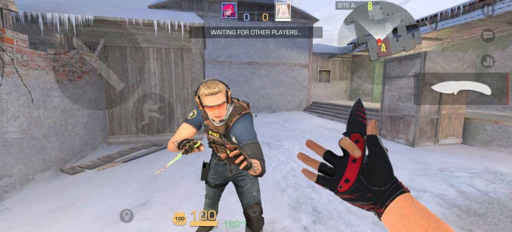
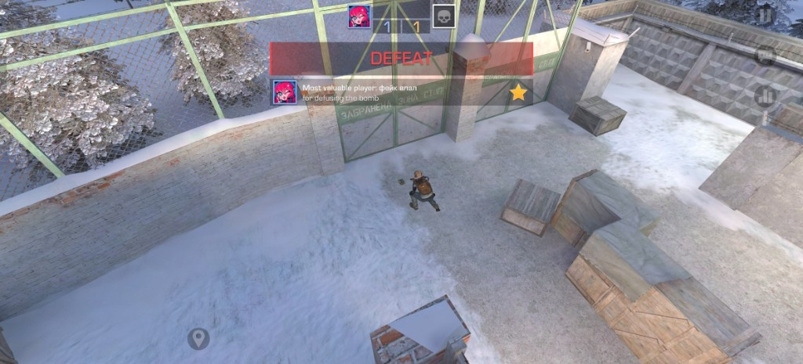

# влалChillow

LAN multiplayer **dedicated server** for [**StandChillow**](https://t.me/chillow) — a Unity mobile FPS with built-in LAN play, but no official dedicated host. This project implements a C# LAN server phones can discover and join on your local network.

Unofficial LAN dedicated server for **self-hosted multiplayer** — reverse-engineering authorized by the game owner. Not an official product and not affiliated with the game publisher.

**Supported client version:** StandChillow **2.07 OBT F1 only**. Version 2.06 is intentionally rejected; other builds are untested.

## What works

- **Lobby** — LiteNetLib on UDP **7778** (join, full roster, chat, mode/map selection, `/end`)
- **Auto-discovery** — 2.07 Bonjour V3 (`SC LAN Bonjour V3`) probe/reply on UDP **5056**; when phones search LAN lobbies, this host appears automatically (same as a phone-hosted lobby)
- **Match channel** — after `play`, clients move to UDP **7777**
- **CLI dashboard** — TTY console + phone chat slash commands (`/mode`, `/map`, `/start`, `/play`, `/end`, …)
- **Reconnect** — a phone that loses the network and comes back **inside the match** keeps its
  actor (same number, same name/team): the host recognises the install by the stable part of the
  2.07 auth token instead of the per-session tail, so no second actor/ghost body appears; INIT is
  granted immediately (the client does not resend its identity) and the host never force-spectates
  a returning player. The old body is destroyed for the remaining peers **and** queued for the
  returning client once its scene is proven, so a retained local scene does not keep a phantom;
  the aggregate world snapshot is delivered exactly once after the world gate opens (no duplicate
  CWO/Rpc). A reconnect during buy/waiting clears the round-local `death` flag and preserves the
  current money balance; a reconnect into an already-frozen round leaves that round like a
  disconnect and re-checks wipe, so an emptied side cannot hang the round (#39, #40)
- **Graceful shutdown** — CTRL+C tears down cleanly; rematch via `play` again
- **ConnectAsClient probe** — optional learning client (`--client`) can observe a real phone host or spawn a visible CT/Tr fighter from the map spawn catalog (see `server/Net/PROBE_README.md`)

### Playable modes (from phone-host gold probes)

| Mode | How to start | Notes |
|------|----------------|-------|
| **Escalation** | `mode escalation` + `map Prison` | Bomb rounds; auto-plant → combat → round end. **Prison only** for now. |
| **Ranked2v2 (Allies)** | `mode ranked2v2` + `* 2x2` map | First-to-8, half-time after round 7, ~10s buy (C2=22), plant/defuse, **109s** host combat timeout |
| **Ranked2v2Alt** | `mode ranked2v2alt` | Same Allies FSM; Alt map half |
| **RankedDefuse** | `mode rankeddefuse` | Same Allies bomb-round flow; first-to-8 |
| **Defuse** | `mode defuse` | Same Allies flow; casual first-to-**6** |
| **Duel** | `mode duel` + map e.g. `Block` | First-to-8 eliminate rounds; host rolls loadouts / round modifiers |

Mode FSMs are driven from ConnectAsClient captures and decompile — not invented. Per-mode notes live under `server/Net/Match/Modes/<Mode>/`.

### Honest limits

- **Escalation** — only **Prison** is a working map right now (other Escalation maps untested / not ready)
- **Duel OnlyGrenades** — modifier fully defined in `DuelLoadouts`, but **RNG-gated off** until host grenade throw works
- **ArmsRace / FreeForAll / DeathMatch** — catalog stubs or not listed as playable; refuse or incomplete wire drive
- Maps: use each mode’s `SelectedLevels` list where the mode is playable

## Load and stability

The dedicated host is built to stay smooth well beyond a 4-phone lobby. Two things used to
make it melt at ~10 players, and both are fixed:

- **Per-packet disk I/O in the network thread.** Every packet used to be written synchronously
  as a capture file *and* logged through a lock into two auto-flushed log files. At 10 players
  that is thousands of file operations per second on the LiteNetLib poll thread: the socket
  receive buffer overflows, reliable packets retransmit (the “ping 200” everyone sees), and
  eventually the event queue backs up until the host stops sending. Captures are now **off by
  default** and, when enabled, go through a single background writer with a bounded queue and
  a file/byte budget. Log lines are queued and batched by one writer thread too.
- **Unbounded fan-out to slow phones.** Broadcasts now check each peer’s reliable queue.
  A peer that cannot keep up gets game ticks dropped (it will rubber-band, but it can never
  stall the room); if the whole send fails the packet is skipped instead of throwing.

Other changes that matter under load:

| Area | Change |
|------|--------|
| Tick loop | 128 Hz busy-poll → 33 ms loop, socket drained first; phase/wipe/fuse checks stay per-tick, `WorldObjectState` ticks every 50 ms |
| Reliable queue | `PacketPoolSize` 1000 → 4096, disconnect timeout 5 s → 10 s (a hiccup no longer kills the session) |
| Logging | `Console.WriteLine` in hot paths is gated behind `--verbose`; silent by default |
| Health line | `[health] peers=… reliableQueue=… slowPeers=… tick avg/max… rx=… op=… gc0=…` every 10 s — see below |

**The wire is unchanged.** No packet format, opcode, field or client-facing timing was
touched — only when/how the host logs and how it schedules its own work. Anything the clients
used to receive in a round, they still receive.

### Debugging a protocol issue

```bash
dotnet run -c Release -- --verbose          # or VLAL_VERBOSE=1
```

`--verbose` restores the old behaviour: per-packet RX/TX lines and capture `.bin` files under
`captures/` (written asynchronously, capped at 4000 files / 64 MB per run). Expect heavy disk
I/O and worse performance — use it only when capturing evidence.

### «Сервер тормозит» — сначала цифры, потом догадки

Every 10 s the match host prints one `[health]` line. The window part answers whether the host
itself is the bottleneck:

```text
[health] peers=6 reliableQueue=0 worstPeer=0 slowPeers=0 droppedSends=0 rttMax=41ms
         stateRx=18342 rpcRx=912
         tick avg=1.2ms max=7.4ms slow=0/300 poll=0.6ms flow=0.3ms
         rx=1837 (94.2KB/s) op=WorldObjectState:1200,WorldObjectRpc:500,SetProperty:137
         gc0=0 alloc=612.0KB/s ws=284.0MB threads=9 captures=off ...
```

| Field | What it means |
|---|---|
| `tick avg/max`, `slow=…` | real cost of one host tick vs `tuning.tickMs` (33 ms), and how many ticks in this window blew the 2× budget |
| `poll=…` | time inside `LiteNetLib.PollEvents` (socket drain + sending) |
| `flow=…` | phase/wipe/fuse machine; if this grows, a mode rule is doing too much per tick |
| `rx=… (…KB/s) op=…` | ingress rate and the noisiest opcodes — a flood is visible even when logging is silent |
| `gc0`, `alloc=…`, `ws=…` | GC pressure, allocation rate and working set (memory leak / capture budget) |
| `reliableQueue`, `slowPeers`, `rttMax` | the phones' side: a growing reliable queue means a slow peer, not a slow host |

A tick longer than 2 × budget also prints a rate-limited `[perf] slow tick …ms (poll=… flow=…)`
line with the same breakdown. If ticks are within budget while `slowPeers`/`reliableQueue`/`rtt`
grow, the host is fine and the problem is the network/phone; if `tick avg` sits near the budget
or `slow` keeps rising, the host machine or a hot path is the bottleneck.

For a report, attach the run's `latest.log` (the `[health]` lines are enough — no need for
`--verbose`, and never commit captures/logs).

## Screenshots

Escalation on Prison over LAN — from lobby ready-up through round outcomes on the dedicated host.

| Waiting for players | After bomb defuse |
|:-:|:-:|
|  |  |
| CT/T roster ready in lobby | MVP awarded on successful defuse |

## Requirements

- StandChillow **2.07 OBT F1** on the same LAN (Wi‑Fi/Ethernet; VPN interfaces are skipped for bind/advertise)
- Linux x64, macOS x64, or Windows x64
- [.NET 8 SDK](https://dotnet.microsoft.com/download/dotnet/8.0) **only when building from source** — downloadable server binaries are self-contained

## Quick start

### Ready-to-run server (no .NET installation)

Every successful build on `main` publishes three artifacts under **Actions → CI → latest successful run**:

- `standchillow-server-win-x64` → run `StandChillow.LanServer.exe`
- `standchillow-server-linux-x64` → run `./StandChillow.LanServer`
- `standchillow-server-osx-x64` → run `./StandChillow.LanServer`

On Linux/macOS, first run `chmod +x StandChillow.LanServer`. Tags matching `v*` also create a GitHub Release with ZIP files for all three platforms.

### Build from source

```bash
cd server
dotnet build -c Release
dotnet run -c Release
```

Phones: open StandChillow → LAN → your lobby should appear → join → chat. The interactive dashboard appears automatically on a real terminal (UTF-8 is enabled for you, no manual `chcp` needed); use `--console` for plain logs, `--dashboard` to force the full-screen UI, `--dashboard-check` to verify the layout without a terminal, or `--dashboard-dump` to print the frames as plain text. See `server/Dashboard/README.md`.

### Ports

| Port | Role |
|------|------|
| **5056/udp** | Discovery only (2.07 Bonjour V3 LAN interoperability probe) |
| **7778/udp** | Lobby (LiteNetLib join after discovery) |
| **7777/udp** | Match (after host starts the game) |

### Starting a match

Two steps matter:

1. **`play`** (or phone **`/play`**) — creates the match channel and moves clients to UDP 7777. Use again for rematch (tears down the previous match).
2. **`/start`** (alias of `start` / `set start` when `anyoneCanStart: true`) — arms WarmUp / waiting exit once both teams have at least one player. Without this, the match stays in waiting (C2=10). With `matchStart.mode: "auto"` the server does this itself.

Typical flow: everyone joins lobby → host picks `mode` + `map` → host runs `play` → both teams pick CT/T → host runs `set start` → WarmUp / buy → live rounds.

### Config file (`config.json`)

On first launch the server writes a **commented `config.json`** next to the executable and
prints where. Edit and save it — running server **picks the change up on its own**, no restart
needed. Comments use `//` and are short on purpose — one line per knob.

A setting that cannot be changed on a live socket (`server.lobbyPort`, `network.*`,
`tuning.packetPoolSize` / `disconnectTimeoutMs` / `netUpdateTimeMs` / `pingIntervalMs`) is
accepted but logged as **«нужен перезапуск»**. A value that is out of range or unparsable is
**never applied silently**: one log line per problem names the bad value and the standard
one that was used instead, e.g.

```
[config] некорректных значений: 1 — применены стандартные
[config]   timings.roundTime: '-5' вне диапазона 10..600 → 109
```

If the file is saved half-written or is not valid JSON, the running server keeps the
settings it already had and says so in the log — it does not fall back to defaults.
The console command `config reload` forces a re-read.

```jsonc
{
  // ----- ЗАПУСК: только для выделенного сервера -------------------------
  "launch": {
    "args": [],              // доп. аргументы, как в командной строке: "--verbose"
    "dashboard": null,       // true / false / null — авто
    "title": null,           // название лобби (null — дефолтное)
    "verbose": false
  },
  "server":  { "welcomeMessage": "…", "maxMembers": 16, "lobbyPort": 7778 },
  "network": { "bindAddress": "0.0.0.0", "ignoreVpn": true, "advertiseIp": null },
  "admin":   { "nicknames": [ "влал" ], "adminOnlyCommands": [ "set", "end" ],
               "anyoneCanStart": true },
  "matchStart": { "mode": "auto", "auto": { … }, "ready": { … } },
  "timings": { "warmup": 3, "preStart": 3, "prep": 10, "roundTime": 109,
               "roundEndPause": 6, "bombFuse": 40, "totalRounds": 8,
               "winsNeeded": 0, "roundStartMoney": 800 },
  "tuning":  { "tickMs": 33, "stateIntervalMs": 50, "reliableQueueSoftLimit": 256,
               "packetPoolSize": 4096, "disconnectTimeoutMs": 10000,
               "netUpdateTimeMs": 15, "pingIntervalMs": 1000, "healthIntervalSec": 10 },
  "debug":   { "verbose": false, "captures": false, "capturesDir": null,
               "capturesMaxFiles": 4000, "capturesMaxBytesMb": 64,
               "matchChat": false, "health": true,
               "logPackets": false, "logDiscovery": false }
}
```

**`launch`** — параметры, которые обычно пишут в командной строке. `launch.args` дописываются
к реальным аргументам (консоль главнее). `--client` там **запрещён**: конфиг не может
переключить сервер в режим пробы.

**`debug`** — только для выделенного сервера. Режим пробы (`--client`) `config.json` не читает
вообще: ни `debug`, ни `tuning`, ни `timings` не влияют на пробу.

**`network`** — где открывать сервер. `bindAddress: "0.0.0.0"` слушает **все** интерфейсы
сразу; задай конкретный адрес, чтобы слушать только его. `ignoreVpn: true` (по умолчанию)
держит VPN/Hamachi/Radmin/ZeroTier в стороне; `false` — сервер слушает и на них.
`advertiseIp` — что писать телефонам в op9 как адрес матча (`null` — авто по LAN);
задай вручную, если играете через Hamachi/Radmin и авто берёт не тот адрес.

**`timings`** — фазы матча в секундах, применяются и через `/set`. `winsNeeded: 0` — взять
дефолт режима (Allies 8, Defuse 6); `winsNeeded: N` — жёстко N и режим его не перебивает.

**`tuning`** — темп хоста. `tickMs` — период цикла, `stateIntervalMs` — рассылка поз,
`reliableQueueSoftLimit` — порог, после которого дропается только косметика (позы/RPC),
`healthIntervalSec` — как часто печатать `[health]` (0 — выключить).

**`debug.captures`** — писать capture-файлы (по умолчанию выключено: на 10+ игроках это
тысячи файловых операций в секунду). Отдельные флаги `logPackets`/`logDiscovery` включают
шумный per-packet лог без общего `verbose`.

**Who is an admin.** Matched by the lobby nickname, case-insensitive. Anyone not in
`admin.nicknames` gets a private «только для админов» reply naming the reason, and the
command does not run. `/help`, `/ready` and `/unready` are always open to everyone.

**`admin.adminOnlyCommands`** defaults to `[ "set", "end" ]`: `/set` changes match parameters,
`/end` stops the match. `/mode`, `/map`, `/start` and `/play` stay open — anyone can run the
match, which is the point of `anyoneCanStart: true`.

> **Careful:** if `admin.nicknames` is empty, **nobody** can run the admin-only commands —
> there is no one left to authorise them. Fill in your nickname:

```json
"admin": { "nicknames": [ "влал" ], "adminOnlyCommands": [ "set", "end" ] }
```

**Three ways to start a match** — pick one with `matchStart.mode`:

| Mode | How the match starts |
|------|----------------------|
| **`manual`** (default) | Only by `/start` or `/set start`. Who may use it is decided by `admin` above. |
| **`auto`** | The server arms the start **by itself** as soon as both teams have at least `auto.minPlayersPerTeam` players. Does exactly what `/set start` does. |
| **`ready`** | Everyone currently **in the match** types `/ready`. The server posts «ник готов (1/3)» in chat and starts once all of them are ready. |

`/ready` is rejected from the lobby — you must be in the match. If a ready player leaves the
match, the vote is dropped and the counter is recalculated, so a leaver can never block the
start. `/unready` cancels a vote (disable with `ready.allowUnready`).

Console helpers: `config` prints the active settings (admins, start mode, timings, tuning,
debug), `config reload` re-reads the file and applies it without a restart.

### Авторизация админа (код на запуск)

Ник присылает клиент — значит «влал» может набрать кто угодно. Поэтому одного ника для прав
мало: ник — это только повод спросить код.

```text
[auth] код админа на этот запуск: 7fKq2mNpR4tXvB8cWy3JhLdS
[auth] код также в файле: C:\Users\влал\Desktop\New folder\auth.txt
```

Код лежит **в двух местах**: в консоли сервера и в `auth.txt` рядом с `config.json` — там же,
где настройки, чтобы не искать окно консоли за игрой. Файл перезаписывается на каждом запуске
и при `auth reset`, а при остановке сервера удаляется (мёртвый код только путает).

- Код генерируется при **каждом** запуске сервера: 24 символа латиницы и цифр
  (`RandomNumberGenerator`, без похожих 0/O/1/l/I). После перезапуска он новый, старый мёртв.
- Пока адрес код не предъявил, игрок с админским ником получает **теневой лобби**, как
  забаненный: в росписи только `Server`, остальные его не видят, команды не работают, в матч
  не пускают. В чат ему приходит:

  ```text
  Server: ник 'влал' админский — нужна авторизация
  Server: код на этот запуск: 24 символов — он в консоли сервера и в auth.txt рядом с config.json
  Server: напиши код сюда, в чат (регистр не важен)
  ```

- Вводится обычным сообщением в чат (можно и `/auth <код>`). Приняли — **этот IP** авторизован до перезапуска
  сервера, и надо зайти в лобби заново (сервер сам отключит сокет). 5 неверных попыток —
  отключение.
- Проверка стоит на всех входах: лобби (включая переподключение), `JoinRoom` в матче, и в
  каждой команде. Мимо лобби на 7777 с админским ником не пройти.
- `auth` в консоли — показать код и список авторизованных адресов; `auth reset` — новый код
  и полный сброс (полезно, если код засветился).
- `/whoami` в чате — что сервер реально знает о тебе: ник как он его видит, id, IP, админ ли
  и введён ли код. Первое, что стоит набрать, если «я не админ».

**Где тебе ответят.** Сервер сам решает канал: в лобби это лобби-чат (OpChat), в катке —
ChatManager на 7777. Ответ идёт в оба, потому что клиент держит лобби-сокет весь матч, но
кадры лобби на экране катки не рисует; поэтому «ответ только в лобби» раньше и означал
тишину. Если катка ещё не приняла пира (`/start` из лобби), ответ не выбрасывается: он в
очереди, свипер раз в секунду пробует снова (TTL минута), а в журнале видно, кого ждали:

```text
[chat] Server → влал (в катке): адресата на 7777 пока нет (2/влал@192.168.1.70(bootstrap ждёт)) — ответ в очереди
[chat] Server → влал (match): забанен Ktulxy на 6д
```

Твой собственный текст тоже возвращается эхом: клиент не рисует своё сообщение сам, он ждёт
кадр от сервера — без эха окно чата выглядело мёртвым. Текст, набранный в катке, сервер
дополнительно отправляет в матч-чат, чтобы его видела вся катка.

**Команда не зависит от канала.** `/set start` из лобби, из чата катки и из консоли сервера
исполняется одинаково; отказ админ-гейта («только админам») тоже приходит туда, откуда писал.
В катке команда распознаётся по нику актора (IP — запасной путь), а не по сокету: матч-пир на
7777 и лобби-пир на 7778 — разные подключения.

**Матч-чат — один канал, и он не дропается.** Чат катки живёт исключительно в
`WorldObjectRpc` на ChatManager (scene id=7): в `captures/chat.zip` на id=7 нет ни
`WorldObjectState`, ни `SetProperty`, а `ReCreateSceneManager` пересоздаёт 4/5/6/8 и чат не
трогает. Поэтому `WorldObjectRpc` чата (и серверного, и релей чужого) идёт тем же
недропаемым путём, что plant/defuse (#33) — иначе сообщение терялось на бэкпрешере молча, и
выглядело это как «сервер вовсе не шлёт в матч». Если адресата нет совсем (в катке ещё никого
или сцена строится за world-gate), сообщение уходит в ту же очередь, что адресные ответы
(свипер раз в секунду, TTL минута), а журнал называет причину:

```text
[chat] Server → match: 'матч armed' — никто не получил (2 пир(а) ещё строят сцену — world-gate держит трафик (до 4 с))
[chat] Server → match: в катке пока никого — сообщение отложено
[chat] Server → match (отложенно, peers=2): матч armed
[match-host] ChatManager text actor=2 (влал) wire-author=2 gaa=3 field=1: /set start
[match-host] TX relay WorldObjectRpc id=7 rpc=2 → peers=2 exceptSender=no(ViaServer) critical=chat
```

Байт перед `gaa` в теле Rpc — **номер актора, вызвавшего Rpc**, а не id метода (метод — это
`field`). Доказательство в капчах: у RadarManager один и тот же `field=7` ходит со значениями
1–4 ровно по числу игроков, у пешек байт совпадает с `owner`, а три сообщения в `chat.zip`
подписаны 1, 2 и 3 («я хост», «я клиент», «ya client»). Серверное сообщение подписано актором
хоста — `1`, «Server»; релей чужого чата байт автора не переписывает. Тот же закон виден и в
живом журнале выделенного сервера: `id=257 rpc=2`, `id=385 rpc=3`, `id=513 rpc=4` — пешка
говорит от имени своего владельца.

**Честный статус матч-чата (проверено latest.log, 3 пира, 2026-11-14).** Серверная сторона
делает всё, что известно из капчур: кадр уходит и доходит (`Server → match: матч armed …
(peers=3)`), но **клиент его не рисует**, и в обратную сторону клиенты не прислали ни одного
Rpc на id=7 — все 80 принятых Rpc были на пешках, RadarManager (id=6) и BombManager (id=8).
То есть чат клиента к нашему ChatManager пока не привязан, и это не вопрос доставки. Две
версии одинаково подтверждены капчурами и ни одна не подтверждена наблюдением:

- `field` у живого чата бывает **1 и 2** (gold `…040303`/`…040308` против `…040310` «сучка»),
  payload одинаковый — значит у ChatManager два метода, и какой из них рисует клиент, мы не
  видели;
- автор кадра — актор; во всех капчурах это **живой игрок с пешкой**, а наш актор `1` —
  «Server» в команде Spectator и без пешки.

Гадать и подставлять значения наугад нельзя (CONTRIBUTING), поэтому есть `/chattest`
(только админ): он отправляет один и тот же текст четырьмя кадрами — автор (Server / живой
игрок) × `field` (1/2) — и пишет в журнал доставку каждого. Прогон в катке показывает, какие
буквы A/B/C/D реально появились на экране; дальше нужный вариант становится единственным в
`SendServerChat`, а диагностика остаётся для проверки.

### Баны (только админ)

```
/ban 25354325 6d лох сасал ахахах   # id, срок, причина (причина — всё до конца строки)
/ban #25354325 30m читы             # «#» можно: так id показан в игре и в /ids
/unban 25354325                     # снять все баны этого id
/bans                               # кто забанен, сколько осталось, причина, кто забанил
/ids                                # кто в катке/лобби: id, ник, IP
```

**Только по id, никаких ников.** Ник присылает клиент: «забань влала» легко превращалось
в бан не того человека (или в травлю по нику), а ников-двойников на LAN никто не отменял.
Id считает сервер, он постоянный и принадлежит человеку. Поэтому:

- `/ban 25354325 6d` — единственная форма. Прислали ник — сервер ответит подсказкой:
  `'Ktulxy' — это не id. Баны только по серверному id: /ban 67776161 6d (свой список — /ids…)`.
- `id` видно в игре в списке игроков и в `/ids` (в лобби и в катке).
- Отдельной команды `/banid` больше нет; старое имя работает как тихий алиас того же `/ban`.
- Внутри запись всё равно хранит ник и все IP человека: id — это адрес команды, а не способ
  ловить нарушителя на входе. Иначе смена ника обходила бы бан.

Срок — от **10 минут до 14 дней**: `30m`, `6h`, `3d`, `1d12h`, а также `30м`, `6ч`, `3д`.
Бессрочного бана нет намеренно: IP на LAN выдаёт DHCP, и вечный бан адреса рано или поздно
достанется ни в чём не виноватому телефону. Границы правятся в `admin.ban.minMinutes` /
`maxDays`.

**Кого нельзя забанить:** админа из `admin.nicknames` (админ проходит и с забаненного IP) и
`Server`. Себя — тоже нельзя.

**Серверный id игрока.** Каждому нику соответствует постоянный id в диапазоне
**1…100 000 000**:

```text
id = LE_uint64( SHA-256( UTF-8( верхний_регистр( normalize( ник ) ) ) ) ) % 100 000 000 + 1
```

Это чистая функция от ника: без состояния, без рандома, без времени и без машины. Один и тот
же ник даёт один и тот же id после рестарта, после удаления каталога сервера, на другом ПК и
на пятом сервере — вход одинаковый, значит и SHA-256 одинаковый. Учитывается ник целиком:
кириллица, эмодзи, пробелы, любые символы. Регистр и пробелы по краям на id не влияют
(`Влал` = `влал` = `  ВЛАЛ  `), невидимые символы срезаются, повторные пробелы внутри ника
схлопываются — ровно как при сравнении ников в банах.

Проверить руками (три независимых инструмента дают одно и то же):

```bash
printf 'ВЛАЛ' | sha256sum     # 5447e992881b4ec7205c759bb3490b19aab71e1f034767fd11a10c95cfe2d99a
printf 'ВЛАЛ' | openssl dgst -sha256   # та же строка
python3 -c "import hashlib;h=hashlib.sha256('ВЛАЛ'.encode()).digest();\
print(int.from_bytes(h[:8],'little')%100000000+1)"   # 25354325
```

`/ids` для ника `влал` на любом сервере покажет `#25354325`: вход один и тот же
(байты `d0 92 d0 9b d0 90 d0 9b`), SHA-256 стандартный, сборка числа явная и
little-endian. В коде рядом с ником нет ни файла, ни конфига, ни времени, ни рандома,
ни номера сервера — меняться нечему. Клиент id **не присылает** — его
считает и пишет в провод сам сервер (см. «Айди в игре» ниже), поэтому подделать его нельзя.
Поэтому `/ban <id>` банит не число, а **человека**:
найденный ник + его IP (id рано или поздно может совпасть у другого ника — 100 млн бакетов
не бесконечны, и на коллизию сервер честно предупредит).

**`/ban` для ушедшего.** Сервер помнит каждую личность в `players` внутри `banlist.json`:
id, ник, все IP, когда заходил. Поэтому `id` можно забанить, даже если читер уже вышел из
катки или отключился, — бан получит его ник и все известные адреса, и следующий вход будет
закрыт. После рестарта справочник читается с диска.

**Айди в игре.** Клиент присылает свой id как actor-свойство `uid` строкой `Offline` — это и
есть заглушка в списке игроков (захват `..._match_tx003_SetProperty_uid_len17.bin`:
`uid = "Offline"`). Сервер подменяет значение на десятичную строку серверного id и рассылает
её всем, включая автора, поэтому вместо `Offline` виден номер, который принимает `/ban`.
Подменить его клиент не может: значение пишет хост, а ник для расчёта берётся из состояния
сессии, а не из пакета. У актора `Server` id — захардкоженная строка `Server`: сервер вне
нумерации игроков. Выключается `admin.ban.exposeIds`.

**Сервер — не игрок.** Его ник (`Server`, тот же, что у синтетического игрока лобби)
зарезервирован: зайти с ним нельзя ни в лобби, ни в катку — соединение отклоняется, слота и
номера актора копия не получает. Резерв считается от ника сервера, а не от литерала в
командах: если сервер переименуют в коде, занять новый ник всё равно будет нельзя.
Сам сервер не банится: `Server` — строка, а `/ban` принимает только числа, так что этим
путём сервер вообще не назвать; присланный ник `Server` отвергается как «это не id».

**Сервер отличим от того, кто им притворяется.** Число, которое даёт хеш слова `Server`
(39772292), — обычный id игрока: он **банится**, и именно по нему видно, что перед тобой не
сервер. Настоящий сервер — только строка `Server`, и она не банится. Игроки строку `Server`
получить не могут: у актора сервера хост всегда пишет своё значение, а любому игроку — его
собственный числовой id. Если клиент пришлёт `uid = "Server"` или чужой id, сервер подменит
значение на id этого игрока; если автор не опознан, свойство отбрасывается.

**Что видят остальные.** Если `admin.ban.notifyEveryone` (по умолчанию да), сервер пишет в
общий чат — и в лобби, и в катку, четырьмя строками. Id идёт сразу после ника: разбан
делается командой `/unban <id>`, и искать это число в `/bans` потом поздно.

```text
Server: Игрок влал забанил Ktulxy!
Server: Айди: 67776161
Server: Длительность бана: 6д
Server: Причина: софт удали, тогда поговорим
```

**Что видит забаненный.** Его сразу выкидывает из катки и из лобби (клиент показывает
`RemoteConnectionClose`). Если он заходит снова, сервер отвечает `JoinResponse` с росписью
**только из Server** — клиент рисует себя сам, поэтому на экране «Server» первым и он вторым,
других игроков нет; про идущий матч не сообщается (`hasHosting=0`, без op7/op9). В чат ему
приходит только это:

```text
Server: Вы были забанены!
Server: Причина: софт ебучий
Server: Забанил: влал
Server: Разбан через: 0д 0ч 29м 12с
```

Строка «Разбан через» обновляется раз в `admin.ban.shadowRefreshSec` (60 с). Его сообщения и
команды игнорируются, остальные его не видят. Раз в `admin.ban.sweepSec` (**5 с**) сервер
проверяет сроки: у кого вышел — снимает бан, чистит `banlist.json` и сразу отпускает теневой
сокет.

**Проверка — три гейта, только на входе** (на пакеты состояния ничего не навешивается):

| Гейт | Когда | Ключи |
|------|-------|-------|
| Лобби (7778) | первый пакет входа, в т.ч. переподключение | ник + IP |
| Матч (7777), коннект | самый первый контакт | IP |
| Матч (7777), JoinRoom | вход **и реконнект** — до выдачи актора | ник + IP |

Третий гейт обязателен: реконнект внутри матча не проходит обычный join, он «усыновляет»
старого актора. Без проверки там читер мог зайти под VPN, выключить его и вернуться
реконнектом уже с забаненного адреса.

**Только ник и IP.** Стабильный токен установки намеренно не используется — чтобы не задеть
нормального игрока, который переустановил игру. Запись бана — это личность: ник, алиасы и
все IP, с которых он приходил. `admin.ban.bindAliases` (по умолчанию `true`) дописывает в ту
же запись новый ник с забаненного IP и новый IP под тем же ником.

**`banlist.json`** лежит рядом с `config.json`, переживает перезапуск и в `.gitignore`.
Время хранится в unix-миллисекундах (UTC) плюс смещение пояса в момент бана и локальная
строка для чтения глазами: смена часового пояса на сервере не сдвинет срок. Запись
атомарная, битый файл не роняет сервер (лог + пустой список).

```jsonc
{
  "version": 1,
  "bans": [
    {
      "Nick": "Ktulxy",
      "Aliases": [ "Ktulxy2" ],
      "Ips": [ "203.0.113.9", "10.8.0.2" ],
      "MatchIds": [ 67776161 ],
      "Reason": "софт ебучий",
      "BannedBy": "влал",
      "CreatedUtcMs": 1763035200000,
      "ExpiresUtcMs": 1763037000000,
      "DurationSeconds": 1800,
      "UtcOffsetMinutes": 180,
      "CreatedLocalIso": "2026-11-13T15:00:00+03:00"
    }
  ],
  "players": [
    { "Id": 67776161, "Nick": "Ktulxy", "Ips": [ "203.0.113.9" ], "LastSeenUtcMs": 1763035200000 }
  ]
}
```

```jsonc
"admin": {
  "nicknames": [ "влал" ],
  "ban": {
    "enabled": true,
    "adminOnly": true,
    "file": "banlist.json",
    "minMinutes": 10,
    "maxDays": 14,
    "bindAliases": true,
    "notifyEveryone": true,
    "shadowRefreshSec": 60,
    "sweepSec": 5
  }
}
```

**Честные ограничения.** Видно ли подменённый `uid` самому игроку, зависит от того, читает ли
клиент это свойство из комнаты или держит своё значение локально — проверяется только в игре. Алиасы учатся в обе стороны и по цепочке: забаненный ник с нового
адреса тянет за собой этот адрес, а любой, кто зайдёт с этого адреса, попадёт в запись и
притащит свои адреса. На квартирном NAT это может расширить бан шире, чем хотелось, —
поэтому потолок 14 дней, `/bans` и `/unban` (цепочку видно по IP в `/bans`). Ник присылает клиент, поэтому админа можно имитировать ником (та же
слабость, что у админ-команд в целом). Id — производная от ника, а не от устройства: сменил
ник — сменился id, и старый бан по id его уже не найдёт (IP при этом остаётся). Один
публичный IP часто делят несколько игроков (CGNAT, NAT в клубе): бан IP задевает всех за ним —
поэтому есть `/bans`, `/unban` и потолок в 14 дней. Это админ-контроль, **не античит**.

### Useful console commands

```
mode escalation          # or ranked2v2, defuse, duel, …
map Prison               # Escalation: Prison only for now; other modes: SelectedLevels
set start                # arm when both teams ready
play                     # launch / rematch
end                      # end match / return path
ban Ktulxy 30m софт      # ban (10m…14d), admin-only
ban 67776161 30m софт     # ban by server-side id (see /ids)
unban Ktulxy             # lift a ban by nick or IP
unban 67776161            # lift every ban tagged with that id
bans                     # active bans with remaining time
ids                      # who is in match/lobby: id, nick, IP
status                   # lobby + match summary
plugins                  # list loaded plugins
config                   # show active config (admins, timings, debug)
config reload            # re-read config.json without restarting
quit
```

Phone chat accepts the same slash commands (`/mode`, `/map`, `/start`, `/play`, `/end`, …).

Optional lobby title as first argument:

```bash
dotnet run -c Release -- "my LAN room"
```

### ConnectAsClient (learning only)

Sniff a **real phone host** to learn protocol — do not use for production hosting:

```bash
dotnet run -c Release -- --client
dotnet run -c Release -- --client --team ct    # visible fighter at catalog spawn
dotnet run -c Release -- --client --team tr
```

Captures are for analysis only — never replayed as host replies. See `server/Net/PROBE_README.md`.

## Plugins

Build the optional Telegram status plugin:

```bash
dotnet build -c Release plugins-src/StandChillow.Plugin.Telegram/StandChillow.Plugin.Telegram.csproj
```

Copy the DLL into `bin/Release/net8.0/plugins/` (the build target does this automatically when the main project was built first). See `server/Plugins/README.md`.

Plugins are admin/display sidecars only — they must not invent wire protocol or replay capture blobs.

## Project layout

```
server/           # Dedicated host (build & run here)
server/Net/Match/Modes/   # Per-mode FSM + probe docs
server/Dashboard/ # CLI dashboard (display-only; UTF-8, cell-exact layout)
server/Plugins/   # Plugin API + loader
server/plugins-src/   # Plugin source (Telegram)
ARCHITECTURE.md   # Internal module map for contributors
```

Reverse-engineering notes and Ghidra dumps stay **local** (`decompiled/`) and are not part of the published tree.

## Protocol fidelity

Everything the server sends is derived from client reverse-engineering and observed LAN traffic. Unknown fields are logged or left unimplemented — not guessed. Discovery auth strings, LiteNetLib keys, opcodes, and game mode IDs match what the mobile client expects.

## Reverse-engineering basis and boundaries

The game owner has authorized the reverse engineering used for this project. Its sole interoperability target is self-hosted **LAN play** with StandChillow 2.07 OBT F1; the project does not connect to or provide access to official online services and contains no anti-cheat bypass.

No game assets, game binaries, or decompiled source code are distributed in this repository. Local reverse-engineering dumps, original binaries, captures, and logs are excluded by `.gitignore`, and the CI hygiene guard rejects them if they are accidentally tracked.

`--client` mode is a protocol-learning tool only. Run it exclusively on networks and game instances you control; it is not a production hosting path or a tool for accessing third-party services.

## License

This project is licensed under the [GNU General Public License v3.0](LICENSE) (GPL-3.0).

You are free to use, modify, and distribute this code. If you build on it or ship a derivative work, that work must also be open source under GPL-3.0 (copyleft).

Copyright (C) 2026 влал (vlalikoffc).

## Scope

Unofficial self-host tooling for StandChillow LAN play, with reverse-engineering authorized by the game owner. Use only on networks and instances you control.
